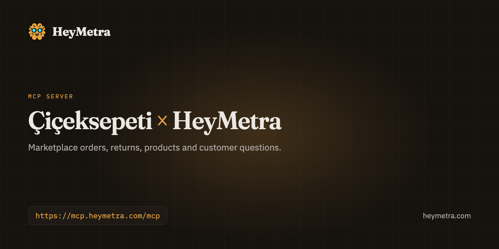

<div align="center">



# Çiçeksepeti &times; HeyMetra

**Marketplace orders, returns, products and customer questions.**

Your orders live in Çiçeksepeti. What you spent to win them lives in your ad accounts. One question, both answers.

[](https://registry.modelcontextprotocol.io/v0/servers/com.heymetra%2Fheymetra/versions)
[](https://modelcontextprotocol.io/)
[](https://heymetra.com/security/)
[](https://heymetra.com/connectors/ciceksepeti/)

```
https://mcp.heymetra.com/mcp
```

</div>

---

## Ask it things like

> How many Çiçeksepeti orders came in this week, and how many are delivered?

> Which products are out of stock on Çiçeksepeti?

> Which customer questions are still unanswered?

No dashboard, no export, no query language. You ask in the assistant you already use and the answer comes back with the account it came from.

## Connect Çiçeksepeti

**1. Ask Çiçeksepeti for API access**

If your store has no API details yet, open Çiçeksepeti Support in the seller panel, start a conversation and choose API Integration Processes. Çiçeksepeti creates the key and sends it.

> Test and live stores get different keys. Ask for the live one.

**2. Type HeyMetra as the Integrator Name**

Under Account Management → My Integration Information in the seller panel, write HeyMetra in the Integrator Name box and save.

> Çiçeksepeti does not require it, but without it every answer carries a warning that the integrator does not match.

**3. Copy the API key and the Seller ID**

Both are on the same screen. The key is shown after you type the code Çiçeksepeti sends by text message to the store's phone.

**4. Paste both in HeyMetra and save**

Saving reads one of your products. A green connection means the store answered.

The same steps are on the docs page: [Çiçeksepeti setup guide](https://heymetra.com/docs/ciceksepeti/).

## Then add HeyMetra to your assistant

Add HeyMetra once and it is there in every conversation. The address is the same everywhere:

```
https://mcp.heymetra.com/mcp
```

### One command

```bash
npx add-mcp https://mcp.heymetra.com/mcp
```

[`add-mcp`](https://www.npmjs.com/package/add-mcp) is a third-party installer that writes the configuration for Claude Code, Codex, Cursor, Antigravity, VS Code and seventeen other agents. It infers the name from the address, so the server lands as `heymetra`. Run against this endpoint before it was written here.

### Or by hand

<details>
<summary><b>Claude</b> — Settings → Customize → Connectors → Add custom connector</summary>

Paste the address above into Settings → Customize → Connectors → Add custom connector.

_On Team and Enterprise plans, an owner adds the connector for the whole organization under Organization settings → Connectors, and each member then connects to it._

Full walkthrough: [heymetra.com/mcp/claude/](https://heymetra.com/mcp/claude/)
</details>

<details>
<summary><b>ChatGPT</b> — chatgpt.com/plugins → + → Add custom MCP server</summary>

Paste the address above into chatgpt.com/plugins → + → Add custom MCP server.

_Add it on chatgpt.com in a browser, because the mobile app cannot add one. Every ChatGPT plan can, Free included. In a Business, Enterprise or Edu workspace, an admin or owner decides whether members can add custom MCP servers. ChatGPT needs the full address, including /mcp at the end._

Full walkthrough: [heymetra.com/mcp/chatgpt/](https://heymetra.com/mcp/chatgpt/)
</details>

<details>
<summary><b>Grok</b> — grok.com/connectors → New Connector → Custom</summary>

Paste the address above into grok.com/connectors → New Connector → Custom.

_On Grok Business and Enterprise, a team admin has to provision the connector in xAI's cloud console before members can use it._

Full walkthrough: [heymetra.com/mcp/grok/](https://heymetra.com/mcp/grok/)
</details>

<details>
<summary><b>Perplexity</b> — Plugins → Add custom → Connector → Add MCP connector → Remote</summary>

Paste the address above into Plugins → Add custom → Connector → Add MCP connector → Remote.

_In an organization, members can add a custom connector only after an admin turns on Allow members to add custom connectors, which is off by default._

Full walkthrough: [heymetra.com/mcp/perplexity/](https://heymetra.com/mcp/perplexity/)
</details>

<details>
<summary><b>Claude Code</b> — claude mcp add --transport http</summary>

```bash
claude mcp add --transport http heymetra https://mcp.heymetra.com/mcp
```

_You can also add the server to a .mcp.json file at the project root. Run /mcp in a session to sign in and to check that it connected._

Full walkthrough: [heymetra.com/mcp/claude-code/](https://heymetra.com/mcp/claude-code/)
</details>

<details>
<summary><b>Codex</b> — ~/.codex/config.toml</summary>

```toml
[mcp_servers.heymetra]
url = "https://mcp.heymetra.com/mcp"
```

_Codex reads the server from an [mcp_servers.<name>] section in config.toml, and you sign in with codex mcp login <name>._

Full walkthrough: [heymetra.com/mcp/codex/](https://heymetra.com/mcp/codex/)
</details>

<details>
<summary><b>Cursor</b> — ~/.cursor/mcp.json, or .cursor/mcp.json in a project</summary>

```json
{
  "mcpServers": {
    "heymetra": { "url": "https://mcp.heymetra.com/mcp" }
  }
}
```

_Cursor signs in to HeyMetra without a client ID or secret, so the server entry needs no auth block._

Full walkthrough: [heymetra.com/mcp/cursor/](https://heymetra.com/mcp/cursor/)
</details>

<details>
<summary><b>Antigravity</b> — ~/.gemini/config/mcp_config.json, or .agents/mcp_config.json in a project</summary>

```json
{
  "mcpServers": {
    "heymetra": { "serverUrl": "https://mcp.heymetra.com/mcp" }
  }
}
```

_Antigravity's documented key for the address is serverUrl, though it also accepts url._

Full walkthrough: [heymetra.com/mcp/antigravity/](https://heymetra.com/mcp/antigravity/)
</details>

## What it may and may not touch

Propose a change to this account. Nothing is sent until you approve it, and HeyMetra cannot undo it afterwards.

Permissions are switched on per connection, and one you leave off is a tool your assistant never sees.

| Permission | What it covers | Changes anything? |
|---|---|---|
| **Full account access** | Lets your assistant read anything in this account to answer your questions. The figures are the provider's own, not ones HeyMetra has checked. It can also propose changes: none is applied until you approve it, and HeyMetra cannot undo one afterwards. | Yes — every change waits for your approval |

<details>
<summary>What each permission lets an assistant do, in full</summary>

- Ask anything about this account and get the answer from its live data. Reads only, and the figures are the provider's own rather than ones HeyMetra has checked.
- Propose a change to this account. Nothing is sent until you approve it, and HeyMetra cannot undo it afterwards.
</details>

Anything that would change something comes back as a proposal you approve. Nothing is applied before your yes, and only on an account you connected with permission to change it. [How that works](https://heymetra.com/security/).

## When something goes wrong

<details>
<summary>Saving fails and the key is right.</summary>

**Why:** A test key. Çiçeksepeti issues separate keys for its test system.

**Fix:** Use the live key from My Integration Information.

</details>

## What HeyMetra reads from Çiçeksepeti

Connect the store with the API key and the Seller ID from My Integration Information in the Çiçeksepeti seller panel, then ask about it from your assistant: orders and their status, returns and exchanges, products with price and stock, and customer questions. When you connect, you choose whether your assistant may also propose changes, such as a price, a shipment, an answer to a question or a decision on a return, and every change it proposes waits until you approve it.

<details>
<summary>About Çiçeksepeti</summary>

Çiçeksepeti is a Turkish online marketplace for flowers, gifts and everyday products, where sellers list items and ship orders.
</details>

## One connection, not seven

The reason to read Çiçeksepeti through HeyMetra rather than through a server that only knows Çiçeksepeti is everything else it can answer in the same breath:

**Ads** — [Google Ads](https://github.com/zeisoft/google-ads-mcp) · [Meta](https://github.com/zeisoft/meta-ads-mcp)

**Analytics** — [Google Analytics 4](https://github.com/zeisoft/google-analytics-4-mcp) · [Google Search Console](https://github.com/zeisoft/google-search-console-mcp) · [PostHog](https://github.com/zeisoft/posthog-mcp)

**Ecommerce** — [Trendyol](https://github.com/zeisoft/trendyol-mcp) · [n11](https://github.com/zeisoft/n11-mcp) · **Çiçeksepeti** · [Amazon Seller Central](https://github.com/zeisoft/amazon-seller-central-mcp) · [ikas](https://github.com/zeisoft/ikas-mcp) · [WooCommerce](https://github.com/zeisoft/woocommerce-mcp)

**Revenue & CRM** — [Stripe](https://github.com/zeisoft/stripe-mcp) · [Zoho CRM](https://github.com/zeisoft/zoho-crm-mcp) · [Zoho SalesIQ](https://github.com/zeisoft/zoho-salesiq-mcp) · [Zoho Marketing Automation](https://github.com/zeisoft/zoho-marketing-automation-mcp)

**Mobile** — [AppsFlyer](https://github.com/zeisoft/appsflyer-mcp) · [RevenueCat](https://github.com/zeisoft/revenuecat-mcp) · [Adapty](https://github.com/zeisoft/adapty-mcp) · [App Store Connect](https://github.com/zeisoft/app-store-connect-mcp)

**Work** — [Jira](https://github.com/zeisoft/jira-mcp)

**Channels** — [Slack](https://github.com/zeisoft/slack-mcp) · [Telegram](https://github.com/zeisoft/telegram-mcp)

The full catalogue is at [heymetra.com/connectors/](https://heymetra.com/connectors/).

## Links

- [Çiçeksepeti connector page](https://heymetra.com/connectors/ciceksepeti/)
- [Çiçeksepeti setup guide](https://heymetra.com/docs/ciceksepeti/)
- [HeyMetra](https://heymetra.com/) — what the product is
- [Setup for every assistant](https://heymetra.com/mcp/)
- [Security and limits](https://heymetra.com/security/)
- [Pricing](https://heymetra.com/pricing/)
- [HeyMetra's own repository](https://github.com/zeisoft/heymetra-mcp)

---

<sub>Built by <a href="https://zeisoft.com">Zeisoft</a>, who make HeyMetra. Not affiliated with Çiçeksepeti. This README is generated from HeyMetra's live connector catalogue and refreshed daily; corrections are welcome as issues.</sub>
